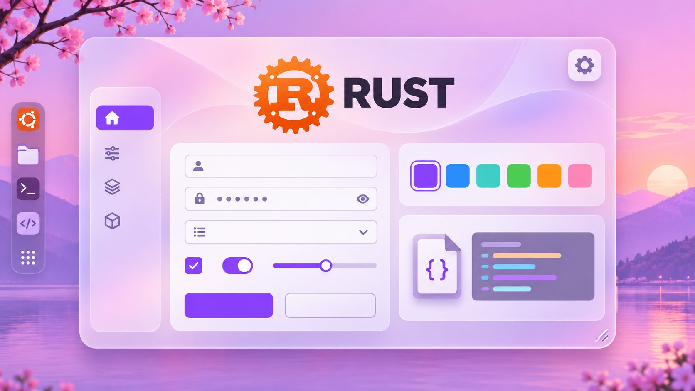
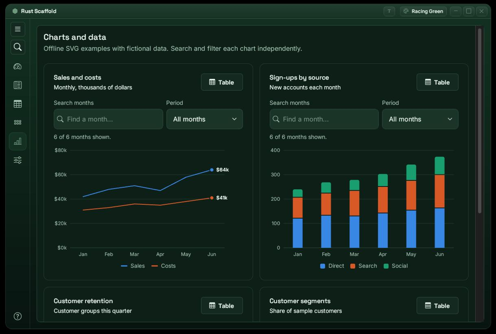
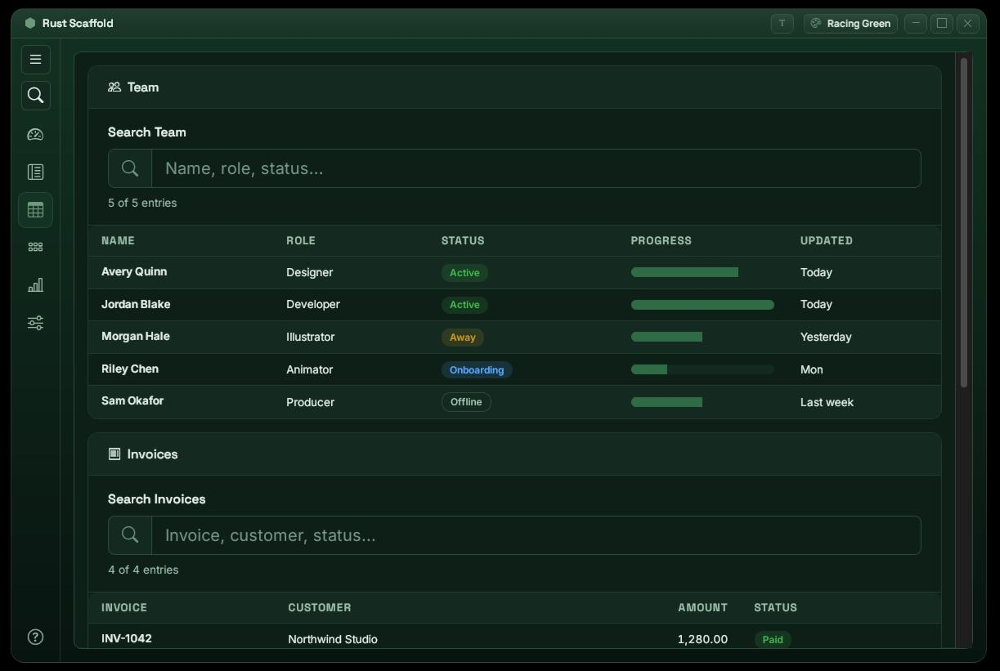
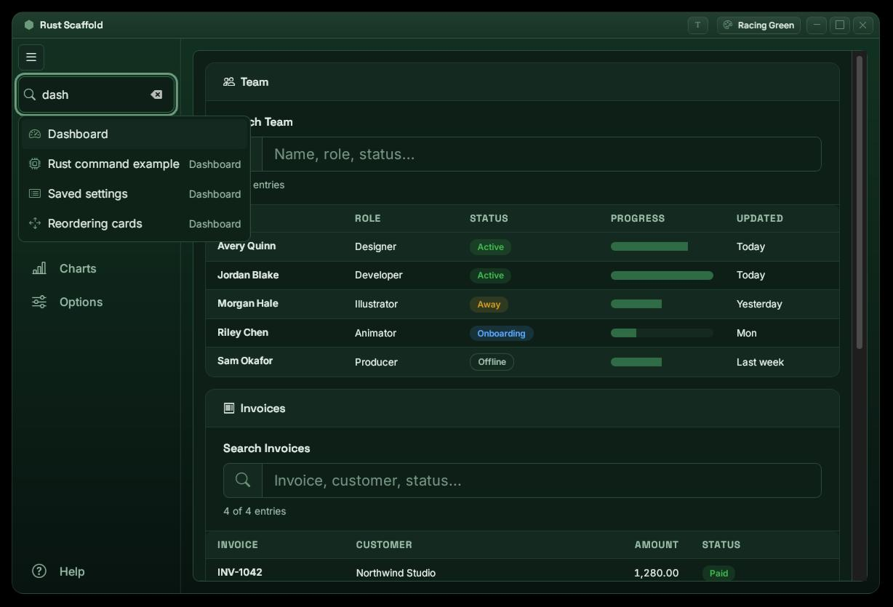
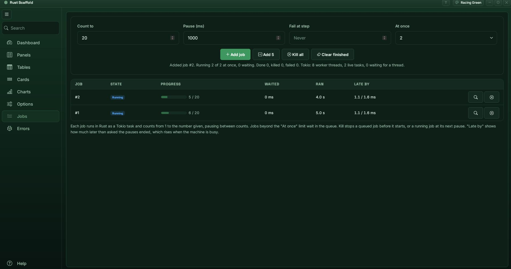

  

<h1 align="center">Rust Scaffold</h1>

  A lean, reusable desktop application scaffold built with Rust and Tauri 2. 
  Frameless, transparent, rounded window with 14 switchable themes, a tray icon and a saved settings file.

---

## What it is

A starting point for small desktop apps. It is application-agnostic: copy the
folder, rename it, and replace the example content. It uses plain HTML, CSS and
JavaScript for the interface (no React, no Vite, no Node.js) and a small Rust
core. The release binary is about 4.5 MB, well under the 50 MB target.

## Features

- Frameless window with rounded corners and real transparency, resizable, with
  a custom title bar (drag to move, minimise, maximise and close buttons).
- Hide or show the title bar. Optional square corners.
- Two menu layouts: tabs across the top, or a vertical menu down the left
  with larger text, a contract and expand button (remembered) and a search
  box. The search jumps straight to a page, card, panel, table or setting
  after three letters; its places are listed in `search.json`, which you can
  edit without rebuilding.
- A Help page with instructions, a change log and the version.
- Accessibility settings: title bar size (100, 150 or 200 percent), text size,
  high contrast, larger click targets, underlined links, a stronger focus
  ring and reduced motion.
- 14 themes, switched at runtime, each with its own subtle background gradient
  and bevelled buttons and containers. The theme and window size are saved.
- Tabs, searchable mock tables, sortable cards and expandable accordion panels.
  Drag-and-drop reordering works with mouse, pen and touch, and with the
  keyboard. The Cards tab has its own saved order and reset button. The order
  and collapsed panels are saved; table searches are local to each table.
- Offline SVG examples of line, stacked bar, doughnut and pie charts. Each chart
  has its own search, filter and data-table view; colours follow the selected theme.
- A tray icon with a context menu you can extend from the settings file, and an
  optional start-minimised mode.
- A settings file (`config.json`) in the per-user settings folder
  (`~/.config/rust_scaffold` on Linux, `%APPDATA%\rust_scaffold` on Windows). It is created on first
  run and whenever it is missing. A file over 5 MiB is treated as corrupt,
  kept as `config.json.corrupt` and replaced with defaults; an invalid file is
  never overwritten.
- An Options tab that edits settings in the app. Its controls (switches,
  checkboxes, radio buttons, text boxes, number boxes, sliders, list groups,
  selects and buttons) are described in `options.json`, which you can edit
  without rebuilding. New settings need no Rust changes.
- GPU rendering by default on Linux with the NVIDIA driver (see
  [GPU rendering](#gpu-rendering)), with an automatic fall back to the CPU and
  a switch on the Options tab.
- An Errors page: warnings and errors (including JavaScript errors) appear the
  moment they happen, pushed from Rust through the `tracing` crate.
- A Jobs page backed by a Tokio job queue in Rust: 1 to 3 jobs run at once,
  the rest wait in order; inspect or kill any job. A ready base for apps that
  need background work.
- Shortcut keys set in `keys.json` (/ or Ctrl+K for search, Alt+1 to Alt+9
  for the pages), with a cheat sheet on the Help page.
- Example of the interface calling a Rust command.
- Bootstrap 5 and Bootstrap Icons, bundled locally. The app works offline.

## Offline graphs and charts

  

## Searchable Tables

  

## Elite Level UX - JSON Search Navigation

  

## ASync Job Queues

  

## GPU rendering

On Linux with the NVIDIA proprietary driver the page is drawn by the GPU. At
start-up the app checks that a GPU buffer can really be allocated, then sets
the two WebKitGTK variables that turn the GPU renderer on
(`WEBKIT_FORCE_DMABUF_RENDERER` and `WEBKIT_DMABUF_RENDERER_FORCE_SHM`).
WebKitGTK does not use the GPU on this driver by default.

- **Needs NVIDIA kernel mode setting on** (`nvidia-drm.modeset=1`, and no
  `nomodeset` on the kernel command line). If it is off, the app falls back to
  the CPU instead of showing a black window.
- **Switch:** "Hardware acceleration" on the Options tab (`hardware_acceleration`
  in `config.json`, default on). It applies at the next start.
- **Which path is active:** the Help page shows "Rendering".
- **Other drivers and Windows:** WebKitGTK's own default applies; nothing is
  forced.
- **Measured** on the test machine (RTX 3060): about 8 to 10 percent less
  web-process CPU while scrolling and switching pages, and less scroll tearing.
  Not measured: drag and resize in GPU mode, and Windows.

Details and the mode-setting steps: [docs/gpu_rendering.md](docs/gpu_rendering.md).

## Requirements

Rust 1.90 or newer (the minimum for Tauri 2.12) and the Tauri system
libraries. You do not need Node.js, npm or the Tauri CLI. The full list is in
[requirements.txt](requirements.txt).

### Versions used to build this release

Built and tested on 13 November 2026 with:

- Rust (rustc) 1.100.0, Cargo 1.100.0, rustup 1.29.3, stable channel
- Tauri 2.12.5, tauri-build 2.7.4 (wry 0.57.2, tao 0.37.2, tray-icon 0.25.1)
- serde 1.0.229, serde_json 1.0.151
- tokio 1.53.1 (async, job queue), regex 1.13.1, time 0.3.55 (dates and
  times), dirs 7.0.0 (settings folder), tracing 0.1.44 and
  tracing-subscriber 0.3.23 (Errors page)
- 436 crates in total, pinned in `src-tauri/Cargo.lock`
- WebKitGTK 2.50.4, GTK 3.24.33, Ubuntu 22.04 (Lubuntu, LXQt, X11)

The app shows the versions it was actually compiled with on the Help page,
under Build: the build time, Rust and Cargo versions, build profile, the
crates the app depends on directly and the total crate count. These are
recorded by `src-tauri/build.rs` at compile time, so they always match the
binary.

## Install Rust and Tauri

### Linux (Debian, Ubuntu, Lubuntu)

Tested on Ubuntu 22.04 with LXQt on X11.

1. Install the build tools and Tauri's system libraries:

       sudo apt update
       sudo apt install build-essential pkg-config curl wget file \
         libwebkit2gtk-4.1-dev libgtk-3-dev libssl-dev librsvg2-dev \
         libayatana-appindicator3-dev

   The official Tauri guide also lists `libxdo-dev`. This project built and
   ran without it. Other distributions: see https://tauri.app/start/prerequisites/

2. Install Rust with rustup:

       curl --proto '=https' --tlsv1.2 -sSf https://sh.rustup.rs | sh

   Then restart the terminal, or run `. "$HOME/.cargo/env"`.

3. Check:

       rustc --version
       cargo --version

4. Optional: install a compositor for the transparent rounded corners on X11
   (`sudo apt install picom`). Without one the corners render black. Wayland
   compositors handle transparency themselves.

### Windows 10 and 11

Not tested on this project. These are the standard Tauri 2 steps.

1. Install the Microsoft C++ Build Tools from
   https://visualstudio.microsoft.com/visual-cpp-build-tools/ and select the
   "Desktop development with C++" workload.
2. WebView2 is preinstalled on Windows 11 and on current Windows 10. If it is
   missing, install the Evergreen runtime from
   https://developer.microsoft.com/microsoft-edge/webview2/
3. Install Rust from https://rustup.rs (download and run `rustup-init.exe`).
   Keep the default `x86_64-pc-windows-msvc` toolchain.
4. Open a new terminal and check:

       rustc --version
       cargo --version

## Build and run

    ./build.sh        Linux: build the release executable only
    ./run.sh          Linux
    run.bat           Windows

`build.sh` builds the release executable and copies it to `dist/`; it reports
build failures and never launches anything. `run.sh` starts `dist/rust-scaffold`
(`./run.sh --build` builds first). The first build downloads and compiles the dependencies and takes
a few minutes (about two on the test machine). Later builds are incremental
and take about a minute.

Or by hand:

    cd src-tauri
    cargo build --release
    ./target/release/rust-scaffold      (Linux)

The app keeps `config.json`, `options.json` and `search.json` in the folder that holds the
executable (`dist/` when started with `run.sh`), wherever it is started from.

## Settings

`config.json`, `options.json` and `search.json` live in the per-user settings
folder, found with the `dirs` crate: `~/.config/rust_scaffold` on Linux and
`%APPDATA%\rust_scaffold` on Windows. This works even when the program is
installed somewhere it cannot write, such as `C:\Program Files`. The folder is
created on first run. If it has no `config.json` yet, the files from the
program's own folder (where versions before 0.2.2 kept them) are copied in
once; the originals are left alone. The environment variable
`RUST_SCAFFOLD_DIR` points the app at another folder (the benchmark uses it).
The Help page shows the folder in use.

`config.json` is created on first run. The app writes your
theme, window size, title bar state, panel order and collapsed panels to it. You
can also edit it by hand while the app is closed.

    {
      "theme": "racing-green",
      "width": 640,
      "height": 480,
      "show_titlebar": true,
      "rounded_corners": true,
      "order": {},
      "collapsed": [],
      "start_minimised": false,
      "tray_items": [],
      "menu_layout": "vertical",
      "menu_collapsed": false,
      "titlebar_scale": 100,
      "text_size": 100,
      "high_contrast": false,
      "large_targets": false,
      "underline_links": false,
      "strong_focus": false,
      "reduce_motion": false,
      "hardware_acceleration": true,
      "extras": {}
    }

`options.json`, also created on first run, decides which settings appear on
the Options tab and how. `search.json` lists the places the menu search can
find, and `keys.json` holds the shortcut keys. Every key is documented in
[docs/usage.md](docs/usage.md).

## Project layout

    build.sh              build release executable only
    run.sh, run.bat       launch from dist/ (--build builds first)
    requirements.txt      system requirements
    dist/                 built executable, with config.json, options.json and
                          search.json (created beside it at first run)
    docs/usage.md         how to use, change and reuse the scaffold
    ui/                   the interface (embedded in the binary at build time)
      index.html
      css/                Bootstrap, the theme tokens and window.css
      js/                 window controls, themes, sortable lists, app logic
      fonts/, img/
    src-tauri/            the Rust side
      src/                main.rs, lib.rs, config.rs, options.rs, search.rs,
                          keys.rs, files.rs, commands.rs, tray.rs, gpu.rs,
                          logging.rs, jobs.rs
      benchmark/          repeatable X11 desktop tests and saved results
      options.default.json  written as options.json when that file is missing
      search.default.json   written as search.json when that file is missing
      keys.default.json     written as keys.json when that file is missing
      tauri.conf.json, capabilities/, icons/, Cargo.toml

## Building a new app from this template

This section is for the developer or AI assistant starting a new project from
the scaffold. Most pages are demonstrations. Keep what the new app needs and
delete the rest.

### 1. Copy and rename

Copy the folder without `src-tauri/target`, `dist/` and `backup/`. Rename the
package, library, product name, identifier and window title; the exact files
and fields are listed in [docs/usage.md](docs/usage.md) ("Use as a template
for a new project"). Set `version` in `src-tauri/Cargo.toml` only;
`tauri.conf.json` has no version, so Tauri takes it from `Cargo.toml`.

### 2. Decide what stays

| Part | Status | What it is for |
|------|--------|----------------|
| Window, title bar, themes, tray, `config.json` | Keep | The app shell. Everything else depends on it |
| Menu (vertical or horizontal) and search | Keep | Navigation for every page |
| Options tab | Keep | Settings screen driven by `options.json`. Holds the menu, title bar and accessibility settings |
| Help tab | Keep, rewrite the text | Usage guide, change log, version, developer |
| Dashboard | Demo | Example of calling a Rust command, and three drag-and-drop cards |
| Panels | Demo | Drag-and-drop accordion whose open and closed state is saved |
| Tables | Demo | Bootstrap tables with a live search box per table |
| Cards | Demo | A second drag-and-drop card list with its own saved order |
| Charts | Demo | Offline line, stacked bar, doughnut and pie charts with search, filter and table view |

### 3. Remove a demo page

Each page is one tab button in `#app-tabs` and one pane in `.tab-content`,
both in `ui/index.html`. Delete both, then:

- Delete the page's entries from `src-tauri/search.default.json` (and from
  `dist/search.json`, or delete that file so it is recreated). Entries for a
  page that no longer exists are skipped and listed on the Help page.
- The first remaining tab button needs `class="nav-link active"` and
  `aria-selected="true"`, and its pane needs `class="tab-pane active"`.
- Tables: also remove `<script src="js/table_search.js">`. Keep
  `css/tables.css`; the chart table view uses it.
- Charts: also remove the `charts_page.js` and `charts.js` script tags and the
  `charts.css` and `charts-page.css` imports in `ui/css/index.css`, unless
  another page draws charts.
- Dashboard: the Rust example and settings cards can go; `app.js` checks for
  them and reports messages in the warning banner instead.
- Keep `js/sortable.js` and `css/sortable.css` while any drag-and-drop list
  remains.

Leftover order and collapsed ids in `config.json` for deleted lists are
harmless.

### 4. Reusable controls

**Drag-and-drop cards and accordions.** Any container with
`data-sortable="list-id"` becomes reorderable: give each child
`class="sortable-item"`, a `data-sortable-id`, and a grip
(``). Mouse, pen, touch
and keyboard (Up, Down, Home, End on the grip) all work, and the order is
saved in `config.json` under `order`. It works for cards (Dashboard, Cards
tab) and for accordion items (Panels tab), where the open or closed state of
each panel (`data-panel-id`) is saved too. A button with
`data-reset-sortable="list-id"` restores the original order. Copy an existing
list from `ui/index.html` as the starting point.

**Charts.** `ui/js/charts.js` is a small offline SVG chart library: column,
stacked, horizontal bar, line, area, pie, doughnut, ring, heatmap and spark
charts, coloured by the current theme, with tooltips, keyboard reading and a
table view. A chart is an element with `data-chart="line"` (or another type)
and its data as JSON in `data-config`, set before the page finishes loading
(charts are drawn on `DOMContentLoaded`); for a chart added later, call
`Charts.init(element)`. Call `Charts.update(element, config)` to redraw with
new data.
`ui/js/charts_page.js` shows the data format for each example; copy a card
from the Charts tab to start.

**Search.** The search box in the vertical menu (Ctrl+K) jumps to any place
listed in `search.json`. Every tab is found by its name automatically, but
**to make a section findable, give its element an `id` and add an entry**:

    { "label": "Invoices table", "page": "tables", "target": "search-invoices",
      "keywords": ["billing", "payments"], "icon": "receipt" }

`page` is the tab id without `tab-`, and `target` is the element's id. Without
a `target` the search can only open the page. Target the most useful element:
a search box or form field gets keyboard focus; a card, panel or section is
scrolled to and outlined. Targets inside a collapsed accordion panel open the
panel. Ship new entries in `src-tauri/search.default.json`; it is written as
`search.json` only when that file is missing.

**Options controls.** The Options tab can show switches, checkboxes, radio
buttons, text boxes, number boxes, sliders, list groups, selects and buttons,
all defined in `options.json` with no code. New settings are stored under
`extras` in `config.json`, and your code reads them from `config.extras`.

### 5. The example options do nothing

The **Examples** group on the Options tab (Nickname, Notes, Units, Start
page, Layout, Volume, Read-only text and its Restore defaults button) only
demonstrates each Bootstrap control. Their values are saved, but nothing in
the app reads them; the Volume slider controls no sound. Delete those entries
from `src-tauri/options.default.json`, or reuse one as the model for a real
setting. Every other option on the tab works.

### 6. Rules that keep it fast and consistent

- **No shadows or blur.** `box-shadow`, `text-shadow` and `backdrop-filter`
  made the maximised window lag; use borders and background tints for depth.
- The interface is embedded at build time: any HTML, CSS or JavaScript change
  needs a rebuild (`./build.sh` or `./run.sh --build`).
- `./build.sh` copies the result into `dist/`. Build experiments with
  `cargo build --release` instead and run them from a separate folder.
- No inline `style=""` (the content security policy blocks it). Put styles in
  the matching file under `ui/css/`, using the tokens in `variables.css`.
- Validate every new `config.json` key in `src-tauri/src/config.rs`.
- `DEBUG_MODE` in `src-tauri/src/lib.rs` (false by default) writes
  `debug.log` in the settings folder when true.

## Known limitations

- **No shadows or blur.** Even one small shadow on cards and buttons made a
  maximised window lag on the test machine. That test was made before GPU
  rendering was enabled and has not been repeated with it. The stylesheets use borders and background tints for depth instead;
  Bootstrap's built-in shadows are switched off in `ui/css/bootstrap-flat.css`.
  See "No shadows or blur" in [docs/usage.md](docs/usage.md). Drag and resize
  performance and Windows have not been remeasured.
- **Linux tray icons** do not receive click or double-click events from Tauri,
  so use the tray menu. On Windows a double-click toggles the window.
- **Transparency** needs a compositor on X11.
- **GPU rendering** is only enabled for the NVIDIA proprietary driver with
  kernel mode setting on; elsewhere the CPU path is used.
- **Windows** support is written but has not been tested.

## Credits

Built with [Tauri](https://tauri.app), [Rust](https://www.rust-lang.org),
[Bootstrap](https://getbootstrap.com) and
[Bootstrap Icons](https://icons.getbootstrap.com).
